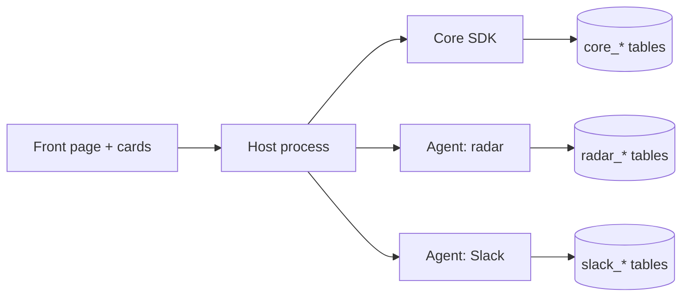
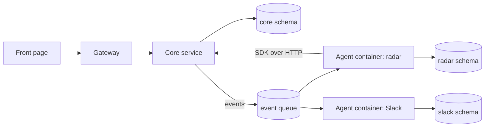
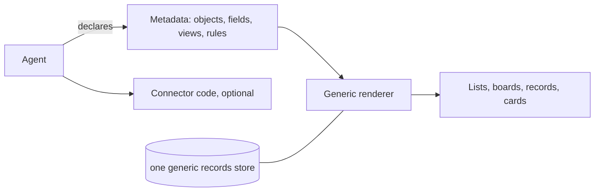
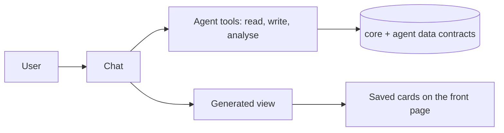
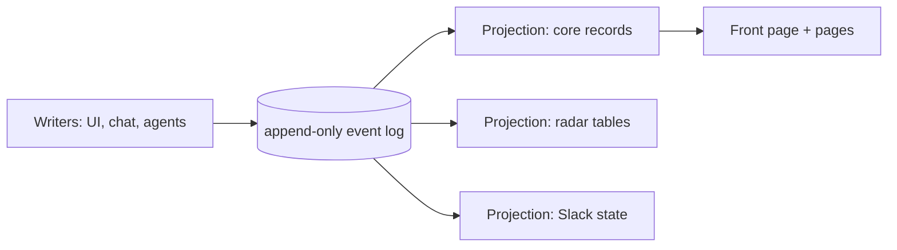

# Five alternative designs for the CRM platform

**Status:** Options for decision. Each option answers the same questions: how agents extend the data, where their code runs, how their UI appears, how they are governed, what they cost to build on this codebase, and where they fail.

The fixed requirements, from the product direction:

- A simplified CRM core (accounts incl. competitors, contacts, opportunities, activities, follows, signals, notifications).
- Agents add data (migrations, custom fields, own tables), logic (tools, events, jobs), and UI (a front-page card and a full page each).
- Sales people can have agents built for them, including declarative ones (custom reports, uploads).
- One instance per client; one database; the operator approves what an agent may do.

---

## Option A: Modular monolith with in-process agents

**Idea.** One Python process and one database. Agents are Python packages loaded at startup from the registry, using the current `AgentSpec` contract plus a manifest. Agents share the process and write core data through a Python SDK. Their UI is served by the host, with iframes for cards.

- **Data extension.** Agents add tables with their prefix and custom fields through the SDK. Core tables are written only by the SDK.
- **Logic.** Agents import the SDK and register event handlers and tools in process.
- **UI.** Cards are iframes served by the host; full pages are served from each agent's folder.
- **Governance.** Manifest scopes are checked by the SDK at call time. Code is trusted (reviewed in the repository); isolation is by convention plus scope checks.
- **Cost on this codebase.** Lowest. It extends `sandbox_host` as it is.
- **Risks.** A buggy agent can crash the host or hold the database. Trusted-code isolation fails for agents generated from the chat. Every agent's dependencies share one environment, so two agents can conflict.
- **Pick when** the team reviews all agent code and the instance count is small (one per client).

---

## Option B: Core plus isolated agent services

**Idea.** The core is one service with the CRM API. Each agent runs as its own container or process, with its own database schema and its own API token. The core and agents communicate over HTTP and an event bus (a table-backed queue is enough at this scale).

- **Data extension.** Each agent owns its schema and migrations. Core records are reached over HTTP with scopes.
- **Logic.** Agents react to queued events and call the core over HTTP.
- **UI.** Cards and pages come from the agent's own container through the gateway, so agent UI is separated by origin.
- **Governance.** Strongest. Each agent has its own credentials, network policy, and resource limits. Revoking an agent is stopping its container.
- **Cost on this codebase.** High. Needs a gateway, a queue, service discovery, deployment changes to Compose, and an SDK over HTTP. Most of `sandbox_host` changes.
- **Risks.** Operational complexity for one-operator instances. Latency on every core read. Harder debugging. Versioning across services.
- **Pick when** agents come from untrusted authors at scale, or clients need hard isolation to pass a security review.

---

## Option C: Metadata-driven workspace (objects and views)

**Idea.** Everything in the product is an object type with fields, views, and relations, defined as metadata. The core ships a few object types (accounts, contacts, opportunities, activities, signals). Agents do not write UI at all: they define object types, fields, views, and automations in metadata, and the platform renders every screen. Agent code only exists for connectors and analysis.

- **Data extension.** Agents declare object types and fields in metadata. Records live in one generic store, typed by the metadata. Migrations are generated from the metadata.
- **Logic.** Rules are declarative (when a signal arrives, notify followers). Code runs only for connectors.
- **UI.** Generated: list, board, detail, and chart views for every object type. Cards and full pages are generated views, with customisation limited to layout and labels.
- **Governance.** Metadata is data, so approval is a diff review. Connector code is the only trusted code.
- **Cost on this codebase.** High for the generic store and renderer, but agents become simpler and the declarative path (from the chat) falls out naturally.
- **Risks.** Generic UIs are weaker than hand-built ones for specialised screens such as the radar. Generic storage gives up typed SQL for reports. Heavy reliance on the renderer, which becomes the product.
- **Pick when** most agents are about data (reports, imports, custom objects) and specialised screens are rare.

---

## Option D: Chat-first agents with generated UI

**Idea.** The chat is the primary interface. An agent is a tool set, a set of rules, and a data contract; it has no fixed screens. When a user needs a view, the platform generates a view from the agent's data contract and the request ("show me this as a board"). Cards are saved views the user keeps. Full pages are rare and exist only for agents that need a bespoke screen.

- **Data extension.** Agents declare data contracts (fields, relations, tools). Migrations are as in Option A.
- **Logic.** Tools do the work; the model decides which to call. Events trigger tool runs.
- **UI.** Generated views from a fixed set of view components (table, board, chart, record). Saved views become cards. A few agents (the radar) keep a bespoke page.
- **Governance.** Tool scopes, plus approval for any tool that writes outside the user's own request. The model's choices are logged.
- **Cost on this codebase.** Medium. The common chat and tools exist. Needs a view generator, saved views, and a logging story for model-driven writes.
- **Risks.** Output varies from run to run; hard to test UI. Users need to trust a model's choice of view. Slow for routine daily use compared with fixed screens.
- **Pick when** users are mostly ad hoc and the team accepts variability in exchange for flexibility.

---

## Option E: Event-sourced core with local-first agent data

**Idea.** The core is an append-only event log (opportunity created, signal detected, activity logged). Every record is a projection of events. Agents subscribe to the log and build their own projections (their own tables). Each client's instance keeps its log; agents can run on a laptop and sync events in and out. The UI reads projections, so it is fast and offline-capable.

- **Data extension.** An agent defines its events and its projections. Core records are projections of core events. Migrations become projection schema changes, rebuilt from the log.
- **Logic.** Agents react to the log and emit events. Idempotency is the agent's responsibility.
- **UI.** Reads projections; cards and pages as in Option A.
- **Governance.** Every change is an event with an actor, so the audit trail is complete by construction. Replaying the log reproduces state.
- **Cost on this codebase.** High. The current code is CRUD. Needs an event store, projection rebuilds, and event versioning.
- **Risks.** Heavy for a CRM whose users expect simple edits and undo. Schema evolution of events is hard. Local-first sync adds conflict handling.
- **Pick when** auditability and replay are central requirements (regulated work), or offline use matters.

---

## Comparison

| | A Monolith | B Services | C Metadata | D Chat-first | E Event-sourced |
|---|---|---|---|---|---|
| Fits current code | Best | Poor | Partial | Good | Poor |
| Agent isolation | Convention and scope checks | Strong | Strong (no agent code) | Tool scopes | Projection scopes |
| Sales-built agents | Declarative engine on top | Hard | Natural | Natural | Hard |
| Specialised UI | Strong | Strong | Weak | Weak | Strong |
| Operations load | Low | High | Low | Low | Medium |
| Audit | Added table | Added table | Added table | Logged calls | Built in |
| Biggest risk | Trusted-code isolation | Complexity | Renderer becomes the product | Variable output | Event schema evolution |

## Recommendation

**Start with Option A and move the declarative path toward Option C.** Option A fits the current host, keeps specialised screens such as the radar, and gives the lowest cost to a working platform. Option C's metadata engine is the right way to build the sales-made, declarative agents, and it can be built inside the same process. Option D's generated views can come later on top of that engine. Options B and E are right if clients or the threat model demand them, and they are expensive to add later, so the first phase should keep the SDK boundary clean enough to move an agent out of process.

## Decisions needed

1. Trusted in-process code only (A), or isolated services from the start (B)?
2. Do sales people build agents through metadata (C), chat-generated views (D), or not at all in phase one?
3. Is an append-only audit trail enough, or does the product need replay (E)?
